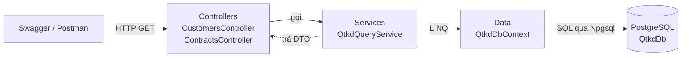
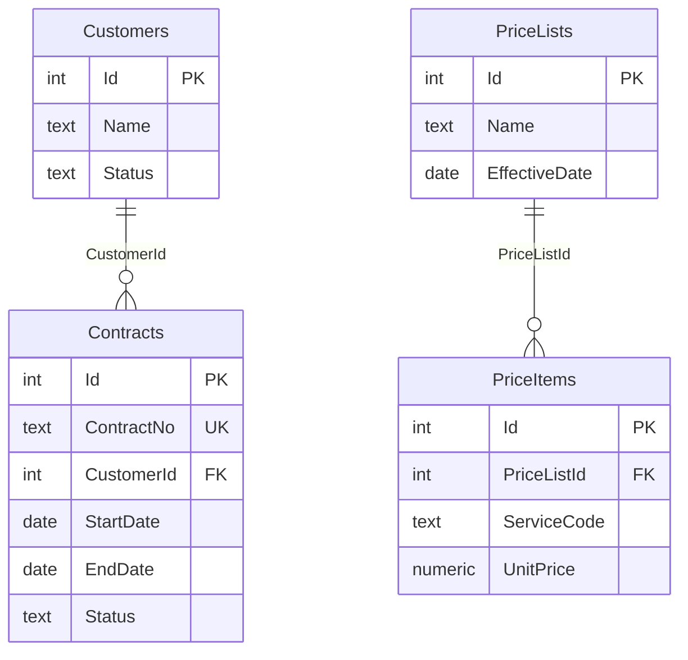

# Sơ đồ thành phần – QTKD.Api (tuần 05)

| Lớp | Thư mục | Trách nhiệm |
|---|---|---|
| API | `Controllers/` | Nhận request, gọi service, trả 200/404 |
| Nghiệp vụ | `Services/` | Truy vấn và chuyển sang DTO; tuần 06 thêm kiểm tra CTR-01..03 |
| Truy cập dữ liệu | `Data/` | Ánh xạ entity ↔ bảng, quan hệ khóa ngoại, dữ liệu mẫu |

## Mô hình dữ liệu

